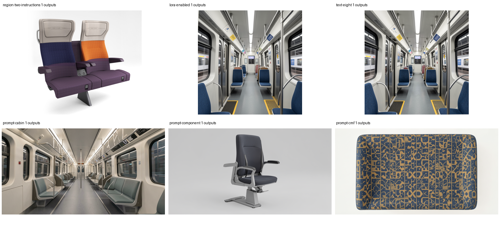
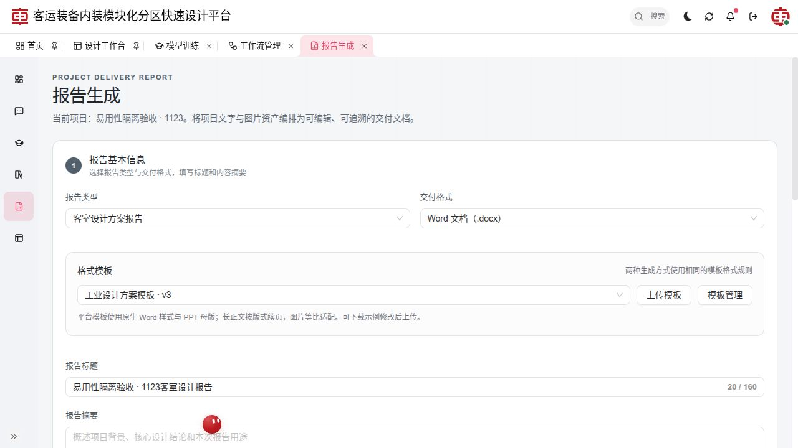
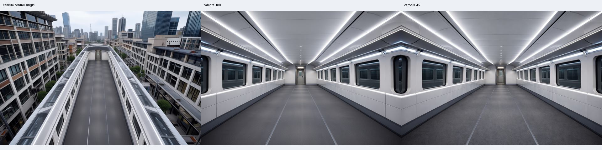
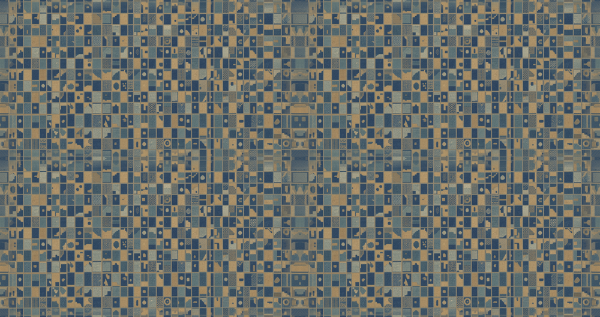
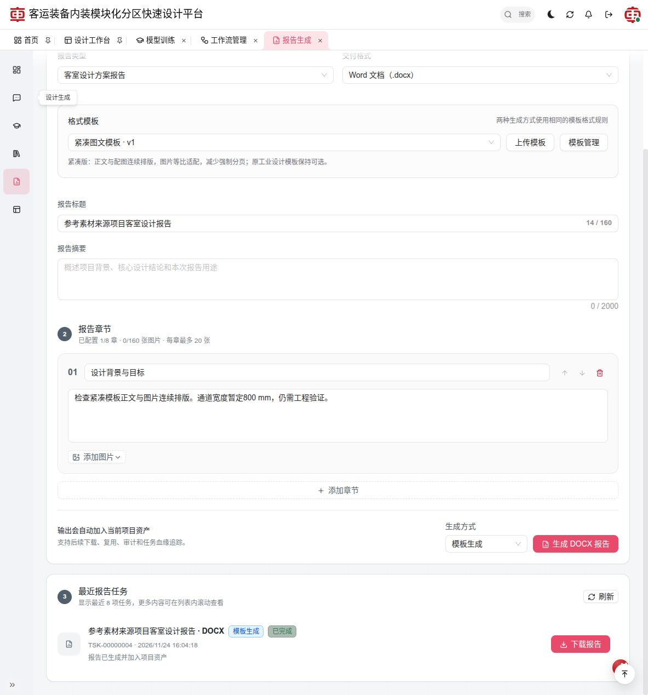

# 2026-11-24 全系统本地测试与问题修复

## 结论与范围

以 `797c62b85aa410feaca2c440630b918e86d91a05` 为平台基线，完成代码回归、真实 PostgreSQL/MinIO 集成、浏览器操作、GPU 推理、短程 LoRA 训练及报告渲染。复现并修复下列五处问题；不把模型返回成功等同于设计效果合格。本轮仅本地修改，未提交 Git、生成交付目录、同步或部署服务器，无新增数据库迁移。

测试使用独立数据库、账号、私有桶、端口及四个临时能力容器，基础模型只读，未下载或替换 AI 权重。浏览器中的三条历史任务使用明确标记的既有图片夹具；新提交的区域标记、双图编辑、LoRA 和报告任务另有真实执行记录。测试环境配置错误和产品缺陷分别记录。

## 已复现并修复的问题

| 编号 | 问题与复现 | 根因与修复 | 验证 |
| --- | --- | --- | --- |
| B1 | 管理员可把三维工作流绑定到文生图，接口返回 200，文生图随后要求四张输入图并输出模型 | 绑定接口只检查发布状态，没有校验应用输入输出契约。按目录标准核验主输出、图片槽位、遮罩/区域及提示词；不兼容返回 `WORKFLOW_CONTRACT_MISMATCH`，事务内保留原绑定。按能力串行替换；管理页仅显示兼容入口并增加更换确认 | 修复后同一请求返回 400，原图像输出和绑定保留；401/403、兼容替换与并发回归通过。并发问题是预防加固，本轮未复现竞态失败 |
| B2 | 离开零部件会话再回来，输入区变成客室文生图；图片编辑草稿也可能恢复到错误功能 | 切会话时重置模式，未读取本人会话最近上下文。API 提供最新草稿或有效轮次的应用与模块；显式图片流转/深链优先，其次恢复本会话上下文，丢弃迟到响应 | 组件回归、本人权限集成、浏览器切换与刷新；自定义文字和零部件模块均恢复。不会反向修正此前已保存成错误模块的旧草稿 |
| B3 | 图片尚未入库，却提示“输出已登记为项目资产”，完成通知也引导到资产页 | 通用 ComfyUI 完成消息与 `saved_at = NULL` 的真实行为不符。改成“生成完成，可保存到资产中心”，通知返回原设计会话；无会话的旧任务返回台账 | 真实 Worker 集成断言文案和通知路径。LoRA/报告原有自动入库行为保留；本轮早先已完成任务的旧消息不回写 |
| B4 | 本地默认 Flux2 VAE 导致真实 LoRA 训练在加载阶段报键名错误 | 准备的 `flux2-vae.safetensors` 是 Diffusers 格式，旧加载器仅识别原生格式。新增严格的双格式加载，保留量化卷积、2×2 潜变量打包和 BN 归一化；原生及 small decoder 路径保留，缺权重明确失败 | 3 项 CPU 数值/格式测试；真实 Flux2 Klein 9B、512 分辨率、rank 16、20 步训练成功，82,866,792 字节、224 张量全部有限，112 个 LoRA B 张量均非零，平台下载哈希一致 |
| B5 | 图片移入子目录后，训练页可选图片由 5 张变成 3 张，子目录图片消失 | 目录操作用当前目录结果覆盖共享项目资产缓存。共享缓存只保存完整项目列表；目录浏览独立筛选，训练页进入和切项目主动刷新 | 状态/页面测试、真实目录移动、浏览器重新进入训练页显示全部 5 张（含子目录 2 张） |

B4 改动位于独立 `ai-toolkit` 源码。根 Compose 原先显式使用的原生 `full_encoder_small_decoder.safetensors` 不变；不能据此称生产 LoRA 一直不可用，也不是缺少 Qwen。实训使用现有测试镜像加挂当前源码，未构建新的生产训练镜像，后续交付须包含该独立镜像更新。

## 功能与逻辑覆盖

| 模块 | 实际检查内容 | 结果与边界 |
| --- | --- | --- |
| 认证、权限、项目 | 登录/刷新、角色与项目隔离、资源参数、管理员不能读取他人私人会话/过程图、审计及对象访问 | 七组真实隔离集成通过；是已覆盖权限用例回归，不是完整渗透测试 |
| 设计输入与图片流转 | 生成结果直接续编、区域标记→图片编辑、双图参考、跨项目选图、保存草稿、快速切换/迟到响应、刷新恢复、旧 LoRA 历史 | 浏览器与真实 API/Worker 验证；原结果不自动入库，选图后归属与血缘正确 |
| 局部编辑 | 两区域独立要求、标记快照、自动编辑入口、带标记输入与无标记结果对比、遮罩/参考遮罩/扩图保护 | 实际 GPU 完成；有效修改范围外像素最大差为 0，羽化和扩展范围计入允许编辑区 |
| 资产中心 | 类别根目录、创建子目录、保存、移动、收藏/复制回归、跨类与越权拒绝、训练页资产联动 | 浏览器及隔离集成通过，修复 B5 |
| 管理工作流/模型 | 不兼容绑定拒绝、确认取消、发布/删除保护、版本与历史快照、模型上传/校验/试运行协议 | 真实数据库/文件系统及模型管理 68 项 HTTP 检查通过；超大权重上传、所有硬件组合未实跑 |
| 可选 LoRA | 兼容/不兼容拒绝、关闭/启用、草稿与快照、Worker 再校验 | 真实兼容 LoRA 推理成功；短程训练不代表风格收敛或长训质量 |
| AI 助手 | 真实本地 Qwen3-VL 文本和图片问答，回复无需刷新 | 浏览器成功显示回复；没有覆盖所有超时/网络故障组合 |
| 报告 | 模板与真实 AI 两模式 × DOCX/PPTX/Markdown；每章 20 张边界、私有下载、自动入库 | 6 个真实任务成功；两章共 21 个图片位置，20 张使用同图重复验证容量/排版，非 20 个不同内容 |
| UI | 首页、工作流管理、设计、训练、报告；390px 宽度下管理页/设计页检查、控制台 | 检查时页面无整页横向溢出；管理表格内部横向滚动，不能称所有页面全设备适配完成 |
| 实时输入 | 现有屏幕/摄像头、槽位与停止逻辑组件回归 | 本轮未实际授予屏幕/摄像头权限或验证物理采集硬件 |
| 三维 | 真实四向图片→GLB，glTF 2 结构与网格验证 | 10,153,848 字节、268,150 顶点、577,498 三角形；未在本轮浏览器旋转/缩放，不代表 CAD 精度或多视图严格一致 |

## 真实 GPU 与效果检查

共 19 个直接 GPU 用例成功：文生图、单图、双图参考、三图融合、单图/参考图局部重绘、扩图、单/多视角、放大、理解、文本、三维，以及双区域、可选 LoRA、8 张输出和三大类默认提示词。另有 2 个经浏览器→平台 API→Worker 的区域标记/双图任务完成真实推理。退役入口仅验证历史与协议兼容，没有逐个运行旧工作流。

- 文生图及三种模块预设实际输出 2048×1080；8 张试验得到 8 个不同像素哈希。
- 单图/参考遮罩、扩图与双区域输出的受保护区域像素差均为 0；单图和参考遮罩内平均变化分别约 3.12/7.11（RGB 0–255）。这说明保护有效，不表示每个修改语义都足够强。
- 双区域测试实现左蓝/右橙且没有在新图叠加编号；多视角一次得到 5 张图。
- 图片理解能描述输入；文本工作流虽完成，但仍输出 `<think>` 段和未经验证的工程尺寸，暂不能直接作为正式工程结论。

## 报告兼容性与视觉复核

两种模式的 DOCX 均经文档运行时渲染为 25 页 PDF/PNG 并检查全部页；PPTX 均经独立 Ubuntu LibreOffice 24.2.7.2 Impress 渲染为 9 页并检查全部页。AI 保留了“800 mm 暂定、尚未验证”等原文约束，未把它变成已验证结论。

项目 Word 兼容性脚本使用真实 AI 内容规划，验证模板/上传模板两模式下 5 张四色检查图完整；设计模板各 9 页、上传固定行高模板各 3 页。故意关闭修复的负面对照只有 0 张完整图，证明检查能发现原裁切问题。版本断言严格为 24.2。宿主机已有 Office 缺少 Writer/Impress 组件，未修改宿主安装；仅解包官方 Ubuntu 软件包建立独立测试运行时。

## 尚未解决的效果问题与建议

| 优先级 | 观察 | 后续处理建议 |
| --- | --- | --- |
| P1 | 单视角大幅变换时，客室内景可能变成车体外景；多向结构细节不完全一致 | 建立固定内景/零部件评测集，限制不适合的角度并比较条件约束与模型参数；需要单独效果实验 |
| P1 | CMF 有时生成带阴影/圆角的织物样片，不是可直接平铺的无缝纹理 | 增加边界连续性测试和专用纹样链，不能仅靠默认提示词保证无缝 |
| P2 | Word 原 PDF 风格一图一页，21 张图片位置形成 25 页，文字页留白较多；PPT 小图页图注偏小 | 在保留已批准模板的同时新增紧凑图文模板，而非静默改写原模板；两模式均按模板渲染，AI 不会自动突破版式 |
| P2 | 文本工作流存在思考段、混合字符及无来源尺寸 | 后续增加最终正文规范化及事实约束评测；正式文档仍需审核 |
| P2 | Markdown 重复内嵌图片使同一材料模板模式约 22.7MB、AI 模式约 2.7MB | 比较图片复用/压缩与离线可读性；本轮未擅自改导出协议 |

未覆盖长时间多用户压力、生产故障注入、多 GPU 并发、长程训练收敛和所有浏览器/硬件。不能据本轮宣称系统不存在其他问题。

## 门禁、证据与交付边界

- `pnpm test:unit`：152 文件、1165 项通过。
- `pnpm typecheck:rail`、`pnpm test:rail:integration`、`pnpm build:rail`：通过。
- 部署脚本 unittest：161 项，6 项按环境跳过；AITK VAE CPU unittest：3 项通过，独立训练 UI 的 5 项测试和类型检查通过；Presenton 模板规划/v2生成/运行限制共 50 项 pytest 通过（1 项依赖弃用告警），不代表整个上游测试集全部执行。
- 本轮文件单独做格式与静态检查。全仓 `pnpm lint` 仍被 59 份既有合同资料格式问题阻断，未记录为全仓通过；初始 253 份合同文件哈希无变化。
- 原始日志、图、GLB、训练模型及报告留在根项目忽略的 `scripts/deployment/work/system-audit-20261124`；精简结果见同目录文档 [JSON 记录](SYSTEM_AUDIT_20261124.json)。测试凭据、模型和临时 Office 不进入 Git。
- 后续发布需平台 Web/API/Worker 与独立 AITK 镜像；本轮没有变更 ComfyUI JSON、模型权重、Presenton 代码或新增环境变量。生产验收和交付目录测试须在后续明确发布任务中执行。

## 后续四项效果优化

本节是用户确认后新增的本地修改，不改变上文首轮审计的历史结论；仍未提交、交付或部署。

| 项目 | 实现及实际验证 | 边界 |
| --- | --- | --- |
| 镜头 | Worker按任务模块加入同场景/同主体约束，保留角度触发词并覆盖全部计划分支。同输入/种子180度由车外变为车内，45度及双视角也成功 | 不保证门窗/部件数量和严格三维几何一致 |
| CMF | 文生图v3增加可关闭的边缘衔接，新CMF草稿开启、其他模块关闭；保存关闭后刷新保留。相对边缘RGB平均差37.50/36.77降至0，中央像素、尺寸和批次保留 | 平铺仍可能看见过渡带或不完整图案周期，不称专业无缝纹样；不额外处理局部编辑，以免破坏保护区 |
| Word/PPT | 可选紧凑Word，原PDF版保留；同21图位置在LibreOffice24.2为25→6页，文档运行时8页。PPT图注10→14pt居中，增加高度。模板/真实AI及平台Worker下载均通过 | 20图位置仍用重复图片验证容量，客户端分页可能不同；法律类保留专业模板 |
| 文本 | 真实Qwen仍输出思考段和无来源数字；归档前清理/截断保护，尺寸、数量、比例、标准等标为待确认，来源数值和比较符独立检查 | 规则不能覆盖所有事实与语言形式，仍需审核，不能视为事实认证 |

真实AI报告复现20图清单重复编号导致502，独立Presenton对超过4张图使用来源顺序常量约束，完整性和数字校验保留；修复后Word/PPT实跑成功，51项相关pytest通过。没有用模板结果伪装AI成功。最初vLLM启动因本轮单卡显存预算失败，停止测试ComfyUI、调整隔离测试预算后恢复，没有改生产配置。GPU轮询脚本曾中断，双视角结果从ComfyUI完成历史取回，不把中断解释为模型失败。

平台153文件/1174单测、ComfyUI节点3项CPU测试通过；类型、静态检查、真实隔离集成及构建以quality-20261124的最终日志为准。Codex浏览器连接超时，经用户重新打开后恢复；已验证紧凑报告提交完成、CMF关闭刷新恢复，无页面控制台错误。本轮需要后续配套交付平台、ComfyUI及独立Presenton，未构建新生产镜像；旧管理员绑定不会自动替换，未升级v3时不显示平铺开关。

